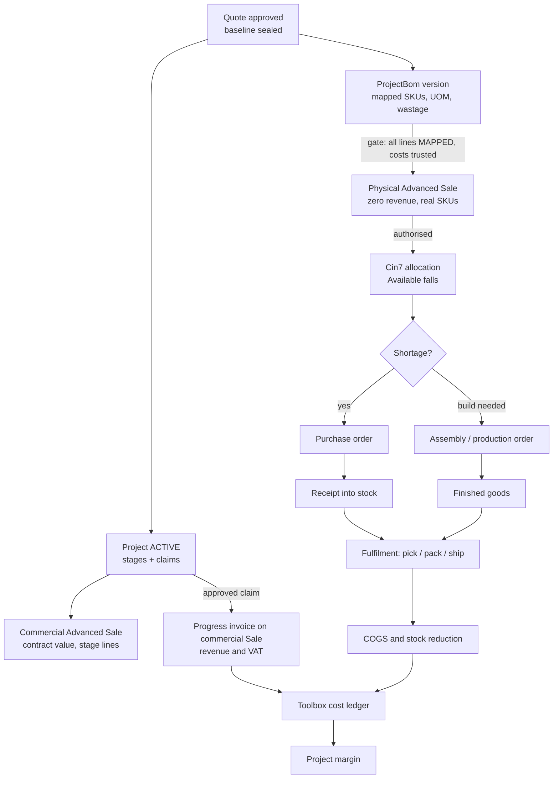
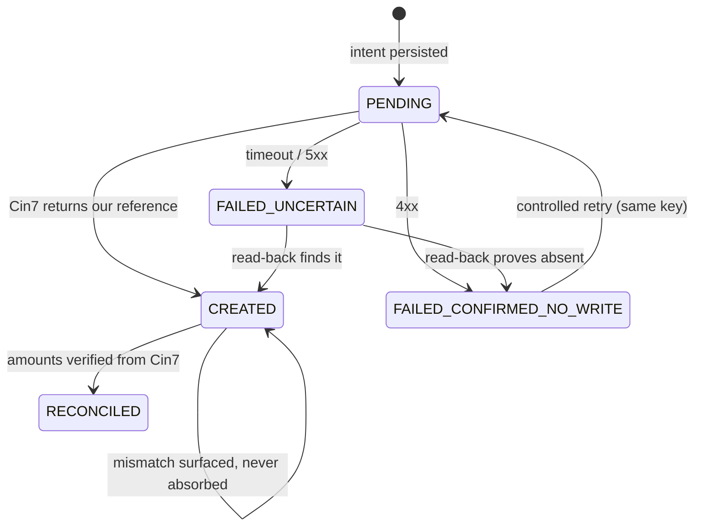

# Architecture review: project materials, manufacturing, progress billing and project costing

Status: **REVISED 2026-10-27 after owner direction (see §0). Proposal; nothing here is built or tested against Cin7.** Written 2026-10-27 for NewQuip (PRs #121 and #122, both DRAFT). No Cin7 write, no hosted schema change and no inventory/manufacturing automation is proposed for immediate action. INV-00021 is untouched. Production writes stay disabled.

Evidence legend: **PROVEN** = confirmed live and recorded in this repo. **OBSERVED** = seen in a real read-only response. **REPO** = established by repo code/docs. **UNVERIFIED** = general Cin7 knowledge or inference; must be tested on a disposable Sale before anything depends on it. Nothing UNVERIFIED is treated as fact below.

---

## 0. Owner direction (2026-10-27)

| Decision | Outcome | Consequence in this document |
|---|---|---|
| **D1** Billing/physical model | **DEFERRED.** One-Sale (A) and two-Sale (B) stay candidates until real Cin7 inventory, invoicing and accounting behaviour is proven. | R1 is a *hypothesis*, not a recommendation. §6 keeps both models; §19 defines the proofs that decide it. |
| **D5** Master data and costing | **APPROVED IN PRINCIPLE.** Cin7 is master for SKU identity, inventory, stock transactions and valuation. Toolbox owns project scope, project-specific BOM mapping, quantities, versions and estimated-versus-actual reporting. Missing SKU mappings are visible exceptions. Placeholder costs are not valid margin inputs. **No financial margin from unverified costs.** | §7.3 becomes a hard rule; §18 lists the minimum data corrections; the exception classes in §8.2 are mandatory. |

Also asked for: T0/T1/T2 proof specifications (§19), a manufacturing-method assessment (§17), the minimum data corrections for a representative project BOM (§18), and a first proof (§21). All documentation only: no Cin7 write, no Supabase mutation, PRs #121/#122 untouched, nothing pushed.

---

## 1. Summary

**The blocker is real.** The POC proves *commercial* state: milestones, progress, claims, variations, and (in #122) one DRAFT progress invoice. It never creates the physical Sale: no SKUs, quantities, allocation, purchasing, assembly, fulfilment, stock reduction or cost. A Cin7 progress invoice made of `AdditionalCharges` therefore bills revenue with no inventory or cost behind it.

**Findings that shape the design**

1. **The scope-to-SKU link does not exist yet, and its inputs are weak.** No Solution Builder BOM rule is VERIFIED (rule register). Of nine quoted outputs, three are single SKUs, four are multi-SKU packages that are not Cin7 assemblies, and one (PVC door) has no SKU at all. Cin7 product costs for most of the sampled NewQuip SKUs are the placeholder `50` ("SUSPECT"; the concrete slat is a real exception), and `price_tiers` is empty. **Any cost, margin or WIP figure computed today would be wrong.** This is a data prerequisite, not a coding task.
2. **Cin7 has no job costing and no usable Jobs API** (P0 §2.7). Project costing must be a Toolbox-owned ledger built from Cin7 documents joined by a reference convention.
3. **One Advanced Sale cannot yet be shown safe for both product and progress billing.** OBSERVED: invoices can precede packing; invoiced quantity can exceed packed quantity; a DRAFT charge-only invoice reduces the Sale's "amount to invoice" by its value without touching fulfilment or COGS. NOT PROVEN: what happens when the product lines of that same Sale are later shipped or invoiced. The likely failure is revenue billed twice (once by charges, once by line invoicing). This must be tested, not assumed.
4. **Consumption is only safe if each material has exactly one consuming transaction**, decided by item class (§5).
5. **Cin7 can already do most of the plumbing** (products and BOMs, purchase orders, stock transfers, quotes are writable via the gateway; sales, purchases, assembly builds, production runs and availability are readable). What is unproven is the *sale order* write path with product lines and its authorisation, and the production-order write path.

**Recommendation (subject to proof tests T1–T6 and accountant sign-off)**

- **R1. (Hypothesis, D1 deferred.) Two linked Advanced Sales per project (candidate model B):** a *commercial* Sale carries the contract value and is invoiced progressively (revenue lives only here); a *physical* Sale carries the real SKUs and quantities, drives allocation, purchasing demand and fulfilment, and carries **no revenue**. Toolbox links them and owns the project view. It is the only candidate that makes double revenue structurally impossible, but it is **not approved**: the single-Sale model (A) stays fully open until T1/T2 show how Cin7 actually behaves.
- **R2. Toolbox owns scope, BOM versions, project cost ledger, claims and the document links; Cin7 owns every transaction it records** (stock, orders, production, dispatch, invoices, VAT, accounting). Sync is read-mostly: Toolbox writes only the documents it creates, once, behind the existing posting state machine.
- **R3. Build in this order:** data hygiene and SKU/BOM mapping, then Toolbox-only BOM model, then read-only demand/cost visibility, and only then Cin7 writes (physical Sale, then production). Costing visibility comes **before** any new Cin7 write.
- **R4. Freeze PR #122 as a draft.** Its writer fits the commercial Sale in model B and a charge-invoice flow in model A; nothing is re-enabled until D1 is decided.

---

## 2. Current state (evidence)

| Fact | Evidence |
|---|---|
| Customer quote is a grouped summary; the sale price per output is formula-driven; stock lines are not shown to the customer | implementation matrix; rule register |
| No BOM item rule is VERIFIED | rule register §"No BOM item rule is VERIFIED" |
| 3 outputs single SKU (tank `SYSH-2750-3`, feeder `PNQ082`, mat `ERT053`), 4 multi-SKU packages (M75 auger, drinker, penning, FORTIS LED), 1 SKU plus separate delivery (slat `NQ1161`), 1 unknown (PVC door) | rule register master table |
| Most Cin7 sample costs are `50` (placeholder, SUSPECT; slat `NQ1161` is a real cost); ERP average costs differ materially; names lost decimals in the NewQuip load | rule register |
| Catalogue: 12,595 products; assembly BOM lines: 5 (assemblies `CP001`, `NQ3173`, neither a Grower item); `price_tiers`: 0 rows | rule register catalogue evidence |
| Assembly BOMs live on the `Product` resource (`BillOfMaterial`, `BillOfMaterialsProducts`, `BillOfMaterialsServices`); Production BOM is `/production/productionBOM`, addressed by product GUID; `BOM type` is one of Assembly / Production / Make to Order / None | api-findings §3, §4; `product-cost.ts` |
| Toolbox can already **write**: products, BOMs, customers, suppliers, work centres, purchase orders, stock transfers, sale quotes (all classified), plus (#122) a progress invoice | `docs/cin7-post-classification.json`; Integration note |
| Toolbox can already **read**: sales (with `Invoices[]`, `Fulfilments[]`, `CreditNotes[]`), purchases, finished goods (assembly builds), production orders and runs (planned vs actual consumption), stock transfers, availability (OnHand, Allocated, Available, OnOrder), product movements (desk research only) | `src/cin7/*`; api-findings §13 |
| A Sale and quote are created in two steps (`POST /sale`, `POST /sale/quote`), with `ExternalID` as the reconciliation key (PROVEN for quotes). **No sale-order write, authorisation or order-line edit exists in the repo.** | P0 §1 |
| P5: a charge-only DRAFT invoice on an Advanced Sale is accepted; fulfilment, stock and COGS stay 0; UI "amount to invoice" fell by the charge incl. VAT | P5 doc (OBSERVED) |
| `AdditionalCharges[].Tax` is a VAT **amount**; Cin7 uses what it is sent | INV-00021 incident |
| Not proven: Xero effects, authorised-invoice COGS timing, over-invoicing rejection, concurrency | P0 banner |
| **The NewQuip POC trial catalogue is seeded.** 10,795 of 12,595 products have `average_cost` exactly 50; 11,021 stock rows have `on_hand` exactly 1,000; seeded stock sits in location MSTR at exactly R50.0000 a unit (stock value 50,000 per 1,000). Real receipts show up in other locations (e.g. `NQ1161` in PROJ: 8,638 units at R184.22). Costing method is FIFO for every product. | OBSERVED (read-only query of the Toolbox sync tables, 2026-10-27) |
| No synced product has a revenue, COGS or inventory account, and stock SKUs have no sale tax rule (only `DEL001` does): either Cin7 applies defaults or the sync does not capture them. | OBSERVED (same query); meaning UNVERIFIED |
| NewQuip trial has 2 assembly builds, 4 consumption lines, **0 production orders, 0 Production BOM versions, 0 operations**, 11 purchases, 34 receipt lines. Two assemblies exist (`CP001`: 2 components; `NQ3173`: 3 components, all components at placeholder cost 50). | OBSERVED (same query) |
| A Sale whose only invoice is a DRAFT charge-only invoice (SO-00015/INV-00019, SO-00019/INV-00021) shows **no invoice number** in the Toolbox cache and `NOT INVOICED`. Existing features that read invoices (e.g. the Closed/Shipped-but-Uninvoiced control) will not see such invoices. | OBSERVED (cache query) |

---

## 3. Project scope to BOM (investigation item 1)

### 3.1 Three layers, not one

| Layer | What it is | Owner |
|---|---|---|
| **Commercial line** | What the customer buys and is billed for (e.g. "CCM feeder x 176", R/line). Grouped, priced by the rule engine. | Toolbox (quote, frozen at approval) |
| **Fulfilment BOM line** | The physical SKU, quantity, unit of measure and location needed to deliver that commercial line. Many-to-one (a package fans out to several SKUs). | Toolbox (versioned), validated against Cin7 products |
| **Execution documents** | Purchase orders, assembly/production orders, picks, shipments in Cin7. | Cin7 |

The sealed accepted baseline (already hashed and frozen) is extended with a **`ProjectBom` version** generated from the same rule inputs. The baseline hash covers the commercial lines; the BOM version has its own hash and a *link* to the baseline so a re-mapped SKU (or corrected cost) never silently changes the contract.

### 3.2 Item classes

| Class | Cin7 representation | Consumed by | Notes |
|---|---|---|---|
| **Purchased stock** (feeder, drinker cup, slat, tank) | Stock product; line on the physical Sale | Sale fulfilment (ship) | Availability via `OnHand - Allocated` |
| **Manufactured assembly** (e.g. a house kit) | Product with `BillOfMaterial` (Assembly) or Production BOM | Components by the build; the finished SKU by fulfilment | Sale lists the finished SKU only |
| **Subassembly** | Same, nested | Parent build | BOM depth and circularity checks in Toolbox before any push |
| **Multi-SKU package that is not an assembly** (M75, drinker, penning) | **Decision D3:** either define a Cin7 assembly per package, or put each component SKU on the Sale | Per decision | Today the catalogue has none |
| **Non-stock service** (delivery `DEL001`, installation labour) | Service product on a PO/bill or sale line; no stock | Expensed on supplier bill | Not on the physical Sale unless it is billed |
| **Installation materials / consumables** | Stock SKUs; issued at site | Fulfilment (ship to site) or a project stock adjustment (issue to project) | Must be in the BOM or they are invisible to the project |
| **Wastage** | An explicit BOM line (`wastage %` rule, visible) or a reasoned stock adjustment tagged to the project | Adjustment | Never hidden inside a quantity |
| **Substitution** | A recorded `substitution` (original SKU, replacement SKU, reason, who approved, cost delta) | Replaces the BOM line; changes the Sale line before fulfilment | If it changes price it is a variation |
| **Approved variation** | A delta BOM (added/removed/changed lines) attached to the variation | Same rules as the base BOM | Never edits the original BOM version |

### 3.3 Rules

- A BOM line is `MAPPED` only when a human has confirmed the SKU. Unmapped lines block the physical Sale and show as a project warning (exactly like the existing readiness BLOCKED state).
- Quantities carry the **unit of measure** and convert only through Cin7's own UOM; no free-floating decimals.
- Variations produce a new BOM *version*; the original is immutable, matching "original contract never moves".

---

## 4. Advanced Sale creation and demand flow (item 2)

### 4.1 What Cin7 needs to see demand

1. A sale **order** with product lines in an authorised state reserves stock (`Allocated`), reducing `Available`. UNVERIFIED for API-created orders.
2. `Available < 0` (or below reorder point) surfaces shortage; the Toolbox already reads availability, reorder points and supplier options.
3. Shortage resolves by: purchase order (Toolbox can already create these through the reconcile-before-retry path), stock transfer between locations, or a build (assembly / production order).

### 4.2 Toolbox automatic creation (proposed, not to be built yet)

```
approved baseline + MAPPED ProjectBom
        │  gate: all BOM lines mapped, costs sane, customer exists, owner+manager approval, flag on
        ▼
 POST /sale (header, ExternalID = PROJECT-REF)   ── ambiguous? reconcile by ExternalID (proven pattern)
        ▼
 POST /sale/quote (product lines by SKU)          ── proven shape for quotes
        ▼
 AUTHORISE as sale order                           ── NOT proven by this repo (test T0)
        ▼
 read back; verify Type = Advanced Sale, lines, totals, allocation; record links
```

The write must reuse the posting state machine from #122 (PENDING first, unique per project, uncertain means reconcile, never blind retry). **A fixture of the physical Sale must be hand-created and read first**, as was done for SO-00015, before any create code exists.

### 4.3 Demand into purchasing and manufacturing

Toolbox shows a **project demand view** (read-only): per BOM line, required vs `OnHand`, `Allocated`, `OnOrder`, shortfall, and the linked PO/build. Creating POs or builds from that view is a *later*, separately approved phase. Until then people act in Cin7 and Toolbox only reads.

---

## 5. Manufacturing and inventory consumption (item 3)

### 5.1 Comparison

| Mechanism | What it does in Cin7 | Consumes | Cost recorded | Toolbox evidence | Use for |
|---|---|---|---|---|---|
| **Assembly (Finished Goods)** | Build an assembly SKU from an Assembly BOM at completion | Components, at completion | Component average cost plus service lines | `/finishedGoodsList`, statuses DRAFT/AUTHORISED/IN PROGRESS/COMPLETED/VOIDED (PROVEN, read) | Simple, short builds with no routing |
| **Advanced Manufacturing (Production Order)** | BOM versions, operations, work centres, resources; planned vs actual | Components when an operation issues stock | Material plus resource cost; has WIP state | `/production/order/run`: actual quantity, actual resource costs per operation (PROVEN, read) | Real fabrication with labour and WIP |
| **Stock transfer** | Moves stock between locations | Nothing (no consumption) | No cost change | `/stockTransferList` (PROVEN, read) | Moving stock to a project/WIP location (optional) |
| **Sales fulfilment (pick/pack/ship)** | Releases goods to the customer | Finished or stock SKUs at ship | COGS at then-current cost (timing UNVERIFIED) | `Fulfilments[]` on Sale (PROVEN, read) | The only point stock leaves to the customer |
| **Stock adjustment / write-off** | Corrects quantity | The adjusted SKU | Cost at adjustment | Desk research only | Wastage, shrinkage, issue-to-project |

### 5.2 The rule: one consuming transaction per material per project

| Material | Consumed by | Never also consumed by |
|---|---|---|
| Component of a manufactured assembly | The build (assembly or production) | The Sale line (the Sale lists the finished SKU only) |
| Finished assembly / purchased stock sold as-is | Sale fulfilment (ship) | A stock adjustment |
| Wastage | A reasoned stock adjustment tagged to the project | The build or the fulfilment |
| Services | A supplier bill (expense) | Stock |

### 5.3 Preventing duplicate consumption

1. **Structural:** a BOM line has exactly one `consumed_by` value; the physical Sale excludes components of any assembly the project builds.
2. **Ledger:** `project_consumption(project, bom_line, cin7_document_type, cin7_document_id, document_line)` with a unique key. A document line can be linked to a project BOM line once.
3. **Reconciliation:** per SKU, Cin7 movements tagged with the project reference are compared with the expected consumption; any excess is an *exception*, not auto-corrected.
4. **No Toolbox-initiated consumption writes** in the first phases (builds and adjustments are done in Cin7 and read back).

---

## 6. Progress billing without double revenue (item 4)

### 6.1 What is known

- OBSERVED (V1): one Sale can hold several invoices; invoices before packing; invoiced quantity above packed quantity.
- OBSERVED (P5): a DRAFT AdditionalCharges-only invoice reduced "amount to invoice" by its value (R1,150 to R1,035) and left fulfilment, picks, COGS and movements at zero.
- NOT PROVEN: (a) what Cin7 does when the **product lines** of that Sale are then shipped and an invoice is raised for them; (b) whether it blocks invoicing beyond the order total; (c) authorised-invoice accounting and Xero.

### 6.2 Candidate models

| | **A. One Sale** (product lines at full price + charge invoices) | **B. Two linked Sales** (commercial + physical) | **C. One physical Sale, stage bills as deposits/pro-forma** |
|---|---|---|---|
| Revenue recorded | Risk of twice: charges plus later line invoice | **Once**, only on the commercial Sale | Once, at delivery invoice |
| Stage tax invoices as contracted | Yes | **Yes** | **No** (stage amounts are payments, not invoices) |
| Inventory and COGS | On the same Sale | On the physical Sale at ship | Same Sale |
| Cin7-side margin report | Skewed by the duplicate | Revenue and cost live on different documents; **Toolbox owns the project margin** | Natural |
| Customer paperwork | One document | Commercial invoice(s) plus an unpriced delivery note | One |
| Needs new proof | T1–T3 | T4–T5 | Contract/VAT review |
| Reversal on cancel | Hard to untangle | Cancel each Sale independently | Simple |

### 6.3 Reasoning for B (hypothesis, not a decision; D1 deferred)

- In model A the order total already includes the product lines. A charge invoice consumes that capacity; shipping the lines then offers an invoice for the same value. Either Cin7 allows it (revenue duplicated), blocks it (physical delivery stalls), or the lines are priced at zero (which is model B inside one document, with worse reporting). None of these is acceptable without proof.
- In model B revenue lives on one document by construction, and the physical Sale can be zero-priced, so no fulfilment can ever bill.
- B fits the already-built writer: the commercial Sale is the Advanced Sale PR #122 links to. Its contract value, VAT and over-invoicing bound can be enforced against that Sale's order total.

### 6.3a Reasoning for A (equally open)

- One document, one customer-facing Sale, native Cin7 reporting, no linking layer. If Cin7 treats a charge invoice as consuming the order's invoiceable value (P5 UI suggests so) **and** refuses to invoice shipped lines beyond it, model A is safe and simpler. Only T1/T2 can show this. If shipments would offer a second invoice for the same value, A is unsafe without a hold-back mechanism.

### 6.4 Costs of B (must be accepted knowingly)

- Cin7's own sales reports show the physical Sale at zero revenue. Project margin is a **Toolbox** number built from both Sales.
- Revenue (stage billing) and COGS (ship) recognise at different times; whether that is the intended accounting is an owner/accountant decision (§11).
- Zero-priced supply and VAT: the tax rule on the physical Sale must not create output VAT or a deemed supply question (§11).

---

## 7. Project costing (item 5)

### 7.1 Cost states (each a separate, additive column)

| State | Meaning | Source |
|---|---|---|
| **Estimated** | Baseline cost from the price snapshot (landed cost x factors) at approval | Toolbox baseline + BOM version |
| **Revised** | Estimated plus approved variation deltas | Toolbox |
| **Committed** | Open purchase order lines tagged to the project | Cin7 purchases (read) |
| **Allocated** | Stock reserved on the physical Sale (cost at current average) | Cin7 availability/sale (read) |
| **Consumed** | Issued to a build or adjusted off | Cin7 finished goods / production runs / adjustments (read) |
| **WIP** | Consumed into a build not yet completed or shipped | Production run status (read) |
| **Delivered** | Fulfilment shipped; cost leaves stock | Cin7 fulfilments (read) |
| **Expensed** | Supplier bills for services and installation; COGS posted | Cin7 purchases/invoices (read) |

Project margin = commercial revenue (invoiced on the commercial Sale, ex VAT) minus Expensed plus Delivered cost, shown beside Estimated for variance. Gross profit and margin are computed only when the cost basis passes the data-quality gate (§1 finding 1).

### 7.2 Joining Cin7 documents to a project

- Every Toolbox-created Cin7 document carries a `NEWQUIP-PROJECTS:<project>:<role>` reference in its Memo/Reference/ExternalID field (field availability **per document type is UNVERIFIED**).
- Documents created by people in Cin7 are attached with an explicit **link** (a manager chooses PO/build/adjustment and role) stored in `project_cin7_documents`; no fuzzy matching.
- Read-only sync into a `project_cost_events` table (document, line, SKU, qty, unit cost, date, state). The ledger is derived and re-buildable; nothing in it is hand-edited.

### 7.3 Cost trust: hard rule (D5)

- Every cost input has a **trust state**: `VERIFIED` (receipt-derived or explicitly attested by the product owner for that SKU, with date and who), `UNVERIFIED`, or `PLACEHOLDER` (cost exactly 50, zero, missing, or from a seeded layer).
- Heuristics only ever *downgrade*: a heuristic can mark a cost PLACEHOLDER but can never mark it VERIFIED. Only attestation or a traceable receipt does.
- **No financial margin, gross profit or WIP value is computed or displayed from a non-VERIFIED cost.** The function returns "not available" with the list of blocking SKUs. Quantities, mapped SKUs, Estimated *units* and Cin7-reported figures may still be shown, clearly labelled.
- Missing SKU mappings and untrusted costs are **visible exceptions** on the project (`UNMAPPED_SKU`, `COST_UNTRUSTED`), never silent zeros.
- Valuation is Cin7's (FIFO here). Toolbox displays Cin7's figures and never re-values stock.

---

## 8. Data ownership, synchronisation and reconciliation (item 6)

### 8.1 Ownership matrix

| Entity | Authoritative system | Direction | Notes |
|---|---|---|---|
| Quote, accepted baseline, project, stages, claims, variations | **Toolbox** | Toolbox only | Frozen and hashed |
| Project scope (commercial lines), BOM versions, mappings, substitutions | **Toolbox** | Toolbox, validated against Cin7 | |
| SKU, UOM, price tiers, supplier options, BOM definition | **Cin7** (Toolbox pushes only approved changes) | Cin7 to Toolbox (read); Toolbox to Cin7 only via the existing product/BOM push | Catalogue hygiene precedes everything |
| Stock on hand, allocation, locations, average cost | **Cin7** | Cin7 to Toolbox | Never edited from Toolbox |
| Sales orders (commercial and physical) | **Cin7** once created | Toolbox creates once, then reads | Link and ExternalID recorded in Toolbox |
| Purchasing, supplier bills | **Cin7** | Read; later optional PO create | |
| Production / assembly | **Cin7** | Read; later optional create | |
| Dispatch / fulfilment | **Cin7** | Read | |
| Invoices, credit notes | **Cin7** | Toolbox creates progress invoices (#122); read back | Revenue |
| VAT | **Cin7 tax rules** (amounts Toolbox-frozen, verified on read-back) | Both ways | INV-00021 shows why amounts are verified, never assumed |
| General ledger / accounting | **Xero** (via Cin7) | Out of scope for Toolbox | Xero effects UNVERIFIED |
| Project cost ledger, margin | **Toolbox** (derived) | Cin7 to Toolbox | Re-buildable |

### 8.2 Idempotency, reconciliation, exceptions

- **One mechanism for every Toolbox-created Cin7 document:** a document posting ledger generalising `project_claim_cin7_postings`: unique per `(project, document role, document key)`, PENDING persisted first, one external call, uncertain means read-back reconcile by exact reference, never a blind retry, amounts verified from Cin7's own figures (null never equals zero).
- **Nightly and on-demand reconciliation:** compare Toolbox expectation with Cin7 per document and per SKU; produce a typed exception list.
- **Exception classes:** `UNMAPPED_SKU`, `COST_UNTRUSTED`, `SHORTAGE`, `UNEXPECTED_CONSUMPTION`, `DOUBLE_LINK`, `AMOUNT_MISMATCH`, `MISSING_DOCUMENT`, `ORPHANED_PENDING`, `CANCELLED_IN_CIN7`. Each has an owner and a manual resolution; none auto-repairs money or stock.

---

## 9. Cin7 API feasibility

| Capability | Status | Needed proof |
|---|---|---|
| Create Sale header and quote lines by SKU with ExternalID | PROVEN (quotes) | Product-line quote on an Advanced Sale |
| Authorise a quote into a sale order via API | UNVERIFIED, absent in repo | T0 |
| Order lines allocate stock on authorisation | UNVERIFIED | T0 |
| Edit an AUTHORISED order's lines (variations) | UNVERIFIED | T6; otherwise variation = new linked Sale |
| Progress invoice via AdditionalCharges | PROVEN (P5), VAT now fixed (#122) | Re-prove on a new disposable Sale |
| Product-line shipment next to charge invoices without duplicate revenue | UNVERIFIED | T1–T3 |
| Over-invoicing rejection | UNVERIFIED | T3 |
| Create/modify Assembly BOM | PROVEN (via `Product`) | |
| Create a finished-goods build via API | UNVERIFIED (read only) | T5 |
| Create a Production Order via API | UNVERIFIED (read only) | T5 |
| Make-to-Order auto-creating builds from sales | UNVERIFIED | T5 |
| Stock adjustment via API | Desk research only | T5 |
| Reference field on every document type | Partial (Memo, ExternalID proven) | Per type |
| Xero propagation of DRAFT/authorised invoices and fulfilments | UNVERIFIED | Accountant + connected org |
| Rate limits | 60/min per Application, gateway-coordinated | Capacity estimate for large BOMs (a 400-line Sale is one request, but reconciliation reads multiply) |

---

## 10. Workflows





---

## 11. Accounting treatment questions (for the owner's accountant)

1. Revenue recognition for stage billing: invoiced as billed, or deferred (contract asset/liability) until delivery/installation? This decides whether model B's timing split is acceptable.
2. VAT on stage invoices (time of supply) and on a zero-priced physical Sale: is any deemed supply or special tax rule needed?
3. COGS recognition: at ship (physical Sale) or matched to revenue? Does Cin7 post COGS at fulfilment authorisation or at invoice? (Observed COGS 0 for draft/unfulfilled only.)
4. Stock valuation method (average vs FIFO) and handling of the placeholder `50` costs before go-live.
5. WIP: is Cin7 Advanced Manufacturing WIP the system of record for WIP, or does Toolbox report it?
6. Installation labour and materials: capitalised to the project or expensed?
7. How do Cin7's Xero sync and manual journals treat draft vs authorised invoices and fulfilments (and a voided DRAFT such as INV-00021)?
8. Credit notes for cancelled stages and variations: which document carries them?
9. Foreign-currency purchase cost (ROE) between receipt and use: where is FX variance booked?

---

## 12. Acceptance scenario (item 7)

Disposable NewQuip POC trial org only; throwaway customer; new Project and claim (not `PRJ-NQ-Q-0001`); all writes behind the flag; each step has a stop condition.

**Happy path:** Quote, approval, Project, mapped BOM, commercial Sale, physical Sale authorised, allocation visible, shortage, PO created and received, assembly built, claim 1 approved and invoiced (DRAFT), partial shipment, claim 2, final shipment, final claim, cost reconciliation.

**Assertions at each stage**

| After | Assert |
|---|---|
| Physical Sale authorised | Type Advanced; lines match BOM; revenue 0; `Allocated` up by BOM qty; commercial Sale untouched |
| PO received | `OnHand` up; ledger Committed to Consumed |
| Build complete | Components down once; finished SKU up; cost = components plus services |
| Claim invoice | One DRAFT; amounts exactly the frozen claim (ex VAT, VAT as amounts, total) read back; no fulfilment/COGS |
| Partial shipment | Stock down by shipped qty only; COGS = qty x cost; **no invoice on the physical Sale**; total revenue unchanged |
| Final reconcile | Revenue = contract (original plus approved variations); Delivered cost = sum of shipments; zero exceptions |

**Failure and edge matrix**

| Case | Expected |
|---|---|
| Partial deliveries (3 shipments) | Remaining qty correct; no duplicate COGS |
| Substitution (SKU B for A) | Recorded; Sale line changed pre-ship or variation; cost delta in ledger |
| Variation V001 | New BOM version and, per T6, a third linked Sale or an edited order; original immutable |
| Retry after timeout | Same key; read-back; at most one Cin7 document |
| Duplicate click / concurrent | One document |
| Cancelled PO / voided invoice / voided build | Ledger reverses by event; project flags `CANCELLED_IN_CIN7` |
| Failed sync mid-run | PENDING aged to uncertain; reconcile; no blind re-send |
| Wrong amounts in Cin7 (INV-00021 shape) | Mismatch surfaced with figures; never RECONCILED |
| Unmapped or untrusted-cost SKU | Physical Sale blocked; costing shows Estimated only |

**Proof tests before any build (all on a disposable Sale, human-operated first, as P5 was; T0, T1 and T2 are specified in full in §19)**

- **T0** Create a product-line sale, authorise it, confirm allocation.
- **T1** Add a charge-only DRAFT invoice to a Sale with product lines; read "amount to invoice".
- **T2** Ship the product lines; observe whether Cin7 offers or creates an invoice for them.
- **T3** Try to invoice beyond the order total.
- **T4** Zero-priced physical Sale: ship, check COGS, VAT and reports.
- **T5** Create a finished-goods build and a production order via API; reference field present.
- **T6** Edit an authorised order line; or confirm a new linked Sale is required for variations.

---

## 13. Owner decisions

| # | Decision | Status | Note |
|---|---|---|---|
| D1 | Billing/physical model: A, B or C | **DEFERRED** by owner | Decided by T1/T2 evidence plus accountant input |
| D2 | Revenue recognition and VAT treatment (§11 Q1, Q2) | Open | Accountant; needed before any AUTHORISED invoice test and before T4 |
| D3 | Multi-SKU packages: Cin7 assemblies or components on the Sale | Open | §17 recommends components on the Sale first |
| D4 | Assembly vs Advanced Manufacturing for NewQuip fabrication | Open | §17; needs NewQuip's actual process |
| D5 | Master data and costing ownership | **APPROVED IN PRINCIPLE** | Terms in §0 and §7.3 |
| D6 | Wastage policy and substitution approval authority | Open | Explicit line, manager approval |
| D7 | Variations: edit the authorised Sale or one Sale per variation | Open | Depends on T6 |
| D8 | Toolbox may create POs/builds, or only read | Open | Read first |
| D9 | Installation: capitalised vs expensed | Open | Accountant |
| D10 | Margin before costs are cleaned | **Resolved by D5** | Not computed from unverified costs |
| D11 | Sandbox for proofs: NewQuip POC trial or Spark Demo | Open, **blocks T0** | §21 proposes the NewQuip trial for T0–T2 (tax rule, account 200 and Xero context match), Spark Demo as the alternative |
| D12 | Fate of PR #122 | Open | Stays DRAFT, flag OFF |
| D13 | Which Cin7 location a project's physical Sale picks from (MSTR holds seeded stock; PROJ holds real receipts) | Open, new | Affects cost and availability |
| D14 | Who attests SKU costs as VERIFIED, and how it is recorded | Open, new | Needed by §7.3 |
| D15 | State of the Cin7 setting "Default Load Advanced Sales Order" for the instance | Open, new | A Sale created in Sales -> Sales is Simple unless this is on; SO-00018 was Simple |

---

## 14. Implementation phases (none start before approval)

| Phase | Content | Cin7 writes | Gate |
|---|---|---|---|
| 0 | Owner decisions D1–D12; accountant answers | None | Written approval |
| 1 | Read-only fact finding: costing method, UOM, reference fields, existing sale-order fixture | None | Report |
| 2 | Data hygiene: SKU mappings, placeholder costs, price tiers, package decisions | Product edits only by NewQuip, in Cin7 | Mapping sign-off |
| 3 | Toolbox-only ProjectBom model, versions, substitutions, variation deltas, demand view (read) | None | Review |
| 4 | Proof tests T0, T1, T2 (§19) then T3–T6, human-operated on disposable Sales; D1 is decided from this evidence | Human only | Evidence recorded and reviewed |
| 5 | Cost ledger from read-only sync; margin hidden until data gate passes | None | Review |
| 6 | Commercial Sale writer (the #122 path, re-proven) | Behind flag | Owner approval |
| 7 | Physical Sale writer (T0 result) | Behind flag | Owner approval |
| 8 | Optional PO/build creation | Behind flag | Separate approval |
| 9 | End-to-end acceptance scenario (§12) | Disposable | Pass |

---

## 15. Effect on the current PRs

- **#121 (POC):** unaffected as a commercial POC; its limits (no physical flow) should be stated in its description.
- **#122 (claim writer):** now corrected for VAT amounts and NaN handling (`09631d2`). It remains DRAFT, unpushed beyond `5718fa2`, flag OFF. It is a candidate for the commercial-Sale writer under model B; nothing is re-enabled before D1 and D2.

---

## 16. Evidence status and what changed in this revision

Added: owner decisions (§0), observed catalogue facts (§2), cost-trust rule (§7.3), decisions D13–D15 (§13), and §17–§21 below. Nothing in §3–§12 asserts a Cin7 behaviour that has not been tagged PROVEN, OBSERVED, REPO or UNVERIFIED.

---

## 17. Manufacturing method: assembly, production BOM, or direct consumption

**Facts.** NewQuip trial: 2 assembly builds, 0 production orders/BOM versions/operations; the Toolbox can read production runs and push a Production BOM and work centres but cannot yet create a production order (UNVERIFIED). The contract's Manufacturing stage is a large share of value, so *something* is made, but the trial data does not show how NewQuip really builds. This is a process question the owner must answer (D4); the assessment below is conditional.

| Item class | Recommended mechanism | Why | Cost recorded |
|---|---|---|---|
| Bought and sold as-is (feeder, mat, slat, tank, cup, LED) | **Direct stock consumption** by sale fulfilment | Nothing is built; fewest transactions, fewest ways to double-consume | FIFO layer at ship |
| Kit shipped as a set (drinker, M75 package, penning kit) | **Direct consumption of components on the Sale** first; **Assembly** only if the kit must be stocked, serialised or sold as one SKU (D3) | A kit that is just "pick these 7 SKUs" needs no build document; an assembly adds a consuming transaction that must not be repeated on the Sale | Components at FIFO; assembly adds service lines |
| Simple fabrication with labour (cut, drill, weld, galvanise) with no WIP tracking need | **Assembly with service components** (`BillOfMaterialsServices`) | One transaction, captures labour as a service cost, supported by the BOM write already in the repo | Components plus service lines |
| Multi-operation fabrication where WIP, work centres and resource time matter | **Production BOM + production order** (Advanced Manufacturing) | Only mechanism with operations, planned vs actual consumption and WIP; Toolbox already reads actual runs | Material plus resource cost; WIP state |
| Moving stock to a project location | **Stock transfer** (optional) | Changes location only; never a consumption | None |

**Conclusion: a combination, defaulting to the simplest mechanism that satisfies the cost question.** Start with direct consumption for everything; add Assembly only for items that are genuinely built or must be one SKU; adopt Production BOM only if NewQuip confirms it needs per-project WIP and resource costing. Mixing is allowed only under the §5.2 rule: **one consuming transaction per material**. A component that is consumed by an assembly build must not also appear as a line on the physical Sale.

**What is needed to decide D4:** a walk-through of how one real house kit is built today (steps, who, where, whether labour hours are recorded), whether NewQuip already uses Cin7 Production, and the accountant's view on WIP (§11 Q5).

---

## 18. Minimum data corrections for a representative NewQuip project BOM

Representative BOM = the nine Grower outputs in the rule register (about 37 distinct SKUs). Read-only comparison against the Toolbox sync of the NewQuip trial:

| Check | Result |
|---|---|
| SKUs present in Cin7 | 35 of 37. **Absent:** `NQ.TUBE.63` (drop tube), `TRA1.1KW3PH` (1.5HP drive; Cin7 has other drives, e.g. `NQ1142` 1/2HP) |
| Cost verifiable | **13** of 35 have a plausible non-50 FIFO cost (`KNQ074`, `KNQ085`, `KNQ160`, `NQ1017`, `NQ1086`, `NQ1089`, `NQ1126`, `NQ1161`, `NQ1163`, `NQ1175`, `NQ1199`, `NQ1380`, `NQ1386`). **22** are exactly R50.00 with seeded stock of 1,000: the tank, feeder (both variants), mat, LED trio, drinker cup/bracket/plate, M75 auger parts, control, drives, posts and fixings. `DEL001` is a zero-cost service |
| Seeded stock | Those 22 show 1,000 at MSTR valued at exactly R50.00 each: an invented FIFO layer. Shipping from it would book COGS of R50, not a real cost |
| Product accounts and tax rules | Not present in the sync for any of them; unknown whether Cin7 defaults apply |
| Units of measure | Quantities are expressed in metres or running metres for the auger and penning, but the SKUs carry UOM `Item`; per-metre pricing/cost is unconfirmed |
| Identity defects | `HNQ7046` is named FERAX 24W (not FORTIS); `HNQ7088`/`HNQ7093` clip/cable labels disagree between workbook and Cin7; support-post SKU truncated (`NQ2601` candidate); no 0.9 m green penning panel found; PVC door has 14 candidates and no confirmed SKU; names lost decimals |
| Locations | MSTR (seeded), PROJ (real history), CPT and one more; no project location policy |

### Minimum corrections (ordered; all are NewQuip actions in Cin7 or sign-offs, not Toolbox code)

1. **Confirm identities** for the unresolved items (PVC door, penning panels, FORTIS/FERAX, clip/cable, support post, drop tube, 1.5HP drive) and create or fix the two absent SKUs. *Unblocks:* `UNMAPPED_SKU` clearing.
2. **Replace the seeded layers** for the BOM SKUs with real stock: either adjust the seeded 1,000 to the true quantity and receive through purchases at real cost, or re-cost, so FIFO holds genuine layers. *Unblocks:* any COGS, WIP or margin figure.
3. **Attest costs** (D14): for each BOM SKU, a named owner confirms the cost basis (receipt, supplier quote or workbook landed cost) and date. *Unblocks:* `VERIFIED` state (§7.3).
4. **Fix UOM** for metre-based SKUs (or state the pack size in the BOM line) so quantities mean what the rule engine produced.
5. **Record the account/tax defaults** Cin7 applies to stock SKUs (revenue 200, COGS, inventory, sale tax rule) so accounting expectations in §19 can be stated exactly.
6. **Choose the picking location** for project stock (D13).
7. **Set or record** "Default Load Advanced Sales Order" (D15) so every project Sale is Advanced.
8. **Package decision** (D3): which packages become assemblies; define those BOMs.

For the *proof tests only* (§19) none of 1–8 is required: the proofs use one seeded SKU whose layer is known (R50.00 at MSTR) so the expected COGS is exact. They are **not** evidence of a real project cost.

---

## 19. Controlled proof specifications: T0, T1, T2

**Common rules.** NewQuip POC trial org (or Spark Demo, D11); throwaway customer; no real claim, project or `PRJ-NQ-Q-0001`; **human-operated in the Cin7 UI**, not through Toolbox code, so Cin7's behaviour is separated from our writer; every invoice stays **DRAFT**; no invoice is authorised in T0–T2; nothing is run until the owner approves the literal fixture sheet in writing; observation is by a read-only inspector (a temporary Preview page like the SO-00018 diagnostic, GET-only, projecting only the fields below, with tests) plus owner screenshots. Any deviation from an expectation is a **finding**, not a failure to be hidden.

**Shared fixture (proposed).** One Advanced Sale, status AUTHORISED, tax rule Standard Rate Sales, terms 30 days, ZAR, location **MSTR**, one product line: SKU `NQ2886` (stock; bracket), qty **2**, price **R500.00** ex VAT, so order total **R1,000.00 / VAT R150.00 / R1,150.00**. Before values (OBSERVED in the Toolbox cache): `NQ2886` MSTR on hand 1,000, allocated 0, available 1,000, stock value R50,000.00 (R50.0000 a unit), costing FIFO.

### T0: physical Advanced Sale, authorised, allocation

**Question answered.** Does an Advanced Sale with a product line reserve stock without invoicing, fulfilling or costing anything?

**Evidence required before authorising**
- E0.1 D11 decided (instance) and the fixture sheet signed: customer, SKU, qty, price, location, tax rule, terms.
- E0.2 A saved read-only "before" snapshot of the SKU's availability row and the highest existing SO number.
- E0.3 The Cin7 setting "Default Load Advanced Sales Order" recorded, and the Sale confirmed Advanced after creation.
- E0.4 The read-only inspector deployed on a Preview, with tests proving GET-only, field projection and manager-only access.
- E0.5 Who captures accounting evidence (the Sale's journal view in Cin7, and the Xero state) and where it is stored.
- E0.6 Rollback written: void the Sale order; expected allocation back to 0.

**Steps (human).** Create the Sale in the UI as Advanced; add the line; authorise the order; do nothing else. Read via the inspector. Then (T0b) void it only if the fixture is not needed for T1/T2, and read again to prove reversal.

**Expected outcomes (hypotheses; UNVERIFIED)**

| Area | Expectation |
|---|---|
| Sale | Type "Advanced Sale"; Order.Status AUTHORISED; sale Status ORDERED |
| Inventory | `NQ2886` MSTR: on hand 1,000 (unchanged), allocated 2, available 998; stock value unchanged R50,000.00 |
| Fulfilment | `Fulfilments` empty; picking/packing/shipping NOT PICKED/NOT PACKED/NOT SHIPPED; FulFilmentStatus NOT FULFILLED |
| Accounting | No journals; no inventory, COGS or revenue movement; `COGSAmount` 0; `InventoryMovements` empty |
| VAT | Order shows VAT R150.00 as a *quote of tax*; **no VAT liability** (no invoice) |
| Revenue / COGS | None / None |
| Xero | Nothing sent |

**Pass.** All rows match. **Stop.** Type is Simple; stock does not allocate; any journal appears; any invoice or fulfilment appears. **Decides.** Whether a physical Sale can drive demand (needed by both models).

### T1: charge-only progress invoice on a Sale that has product lines

**Question answered.** When a Sale already carries priced product lines, what does a progress invoice made of AdditionalCharges consume, and what does Cin7 say is still invoiceable? Run in the **worst case for model A**: the charge bills 100% of the order value.

**Evidence required before authorising**
- E1.1 T0 passed and recorded; fixture still AUTHORISED with qty 2.
- E1.2 The Xero connection state recorded (which organisation, demo or real, and whether sync is automatic); DRAFT invoices proven not to sync, or the owner accepts the effect.
- E1.3 The literal invoice sheet signed: one AdditionalCharge, R1,000.00 ex VAT, Tax **R150.00 as an amount**, Total R1,000.00 (net), Standard Rate Sales, account 200, DRAFT, memo `T1-<date>`, dates.
- E1.4 Before snapshot taken (Sale, availability, "amount to invoice" screenshot).
- E1.5 Written statement that no invoice will be authorised in T1.

**Steps (human).** Create the DRAFT charge-only invoice in the UI exactly as signed. Read back; screenshot "amount to invoice", invoice lines, order tab.

**Expected outcomes (hypotheses)**

| Area | Expectation |
|---|---|
| Invoice | One DRAFT invoice; ex VAT R1,000.00; VAT R150.00; total R1,150.00; memo exact |
| Order | Lines and totals unchanged R1,000 / R150 / R1,150 |
| Amount to invoice | Falls from R1,150.00 by the invoice value, to R0.00 (P5 saw R1,150 to R1,035 for R115) |
| Product line invoiced quantity | Unchanged at 0 of 2 (charge invoice does not invoice quantity) |
| Inventory | Allocated 2, on hand 1,000, available 998: unchanged |
| Fulfilment / COGS | None; `COGSAmount` 0 |
| Accounting | DRAFT: no journals. (Authorising would debit receivables R1,150, credit sales account 200 R1,000, credit output VAT R150; **not** done in T1) |
| Revenue / VAT | None recognised while DRAFT |
| Xero | Nothing, if DRAFT does not sync (E1.2) |

**Pass.** Rows match. **Findings to record either way.** Whether "invoiced quantity" for the product line moved; whether Cin7 blocks or warns; whether it shows over-invoicing. **Stop.** Cin7 authorises or posts anything; an unexpected journal or Xero effect. **Optional T1-AUTH** (authorise the invoice) is a **separate gate**, only with E1.2 showing a demo Xero organisation and the accountant's written answers to §11 Q1–Q3, because it creates real receivable, revenue and VAT entries. **Decides.** Half of D1: does the charge invoice consume the order's invoiceable value.

### T2: partial shipment of the product lines after a charge invoice exists

**Question answered (the decisive one for D1).** After 100% of the order value has been billed by a charge invoice, what do shipping and invoicing the product lines do to revenue, VAT, COGS and stock?

**Evidence required before authorising**
- E2.1 T0 and T1 (DRAFT) passed.
- E2.2 Fulfilment workflow settings recorded (pick/pack/ship steps, any "invoice on ship" or auto-authorise setting).
- E2.3 A documented reversal path for a shipped fulfilment (void/un-authorise), with the acceptable residue stated: at worst 1 unit of seeded stock and one R50.00 FIFO cost movement in a trial org.
- E2.4 The FIFO layer for `NQ2886` MSTR recorded (R50,000 / 1,000), so COGS can be predicted exactly.
- E2.5 Accountant's written position on where COGS posts (§11 Q3) or an explicit decision to treat T2 accounting as observation only.
- E2.6 Owner approval of the literal step list; no invoice authorised.

**Steps (human).** Pick, pack and ship **1 of 2** units. Read back. Then open the Sale's invoice options **without authorising**: record what Cin7 offers for the shipped unit; if it allows a DRAFT product-line invoice, create it at R500.00 and record total drafted value against the order. Do not authorise anything.

**Expected outcomes (hypotheses; the discriminating ones are in bold)**

| Area | Expectation |
|---|---|
| Fulfilment | Shipped for 1 unit; status partially fulfilled; Sale not closed |
| Inventory | `NQ2886` MSTR: on hand 999, allocated 1, available 998; stock value R49,950.00 |
| COGS | R50.00 (1 x R50.0000 FIFO layer), recorded at ship or at invoice (**timing is a finding**) |
| Accounting | Inventory credit, COGS debit R50.00 at the recognition point; no revenue |
| Revenue / VAT | None while all invoices are DRAFT |
| **Invoiceable value after the charge invoice** | **H1:** Cin7 still offers the shipped unit at R500.00 (+R75 VAT), so potential billing R1,500 on a R1,000 order: **model A unsafe without a hold-back**. **H2:** Cin7 offers nothing / reports R0 left to invoice: **model A safe for billing**, with revenue split by account to be reviewed. **H3:** Cin7 auto-creates an invoice on ship: record and stop (a billing event model A cannot control) |
| Xero | Nothing from DRAFT; fulfilment effects recorded as observed |

**Pass.** The behaviour is recorded completely (it need not match a hypothesis). **Stop.** Any invoice is authorised; unexpected COGS amount other than R50.00; any journal outside the expected set. **Decides.** The other half of D1 (A vs B), plus when COGS is recognised, which feeds the cost ledger design.

---

## 20. Test matrix

| ID | Question | Prerequisites | Operator | Reversible | Decides | Status |
|---|---|---|---|---|---|---|
| T0 | Product-line Advanced Sale authorised: allocation only? | D11, fixture sheet, inspector, rollback | Human (UI) | Yes (void order) | Demand model for A and B | Specified, not approved |
| T1 | Charge-only invoice on a Sale with product lines: what is consumed? (DRAFT; T1-AUTH separate) | T0, Xero state, literal invoice sheet | Human (UI) | Yes (void DRAFT) | D1 (half) | Specified, not approved |
| T2 | Ship product lines after a full charge invoice: revenue, VAT, COGS, stock | T0, T1, fulfilment settings, reversal path | Human (UI) | Mostly (void fulfilment) | D1 (decisive), COGS timing | Specified, not approved |
| T3 | Invoice beyond the order total: rejected? | T1, T2 | Human | Yes | Over-invoicing guard | Not specified |
| T4 | Zero-priced physical Sale: ship, COGS, VAT, reports | D1 leaning B, accountant | Human | Mostly | Model B viability, VAT | Not specified |
| T5 | API creation of builds, production orders, adjustments; reference fields; Make-to-Order | D4 | Human then Toolbox | Mostly | §17 mechanism | Not specified |
| T6 | Edit an authorised order line or require a new Sale | T0 | Human | Yes | D7 | Not specified |

---

## 21. Proposed first proof: **T0**

**Why T0 first, and not T2 (the most informative).** T2 cannot run without T0's fixture, so T0 is the mandatory first step regardless of which test matters most. T0 is also the smallest and fully reversible step: it needs no invoice, no fulfilment, no cost and no Xero effect; it proves the physical-Sale prerequisite that both models rely on; it validates the read-only inspector that T1 and T2 will use; and it records the instance setting (D15) that made SO-00018 a Simple Sale. The fixture is deliberately left AUTHORISED (not voided) so T1 and T2 reuse it.

**What the owner needs to decide to start**
1. D11: run on the NewQuip POC trial (recommended for parity with tax rule, account 200 and Xero) or Spark Demo.
2. Approve the shared fixture (customer, `NQ2886`, qty 2, R500.00, MSTR) or substitute one.
3. Approve a temporary read-only inspector page (same pattern as the SO-00018 diagnostic), which I would build and test before T0, with no Cin7 write and removed afterwards.
4. Confirm who performs the Cin7 UI steps and who captures the accounting/journal evidence.

Until those are given: no Cin7 write, no inspector deployed, nothing pushed.
